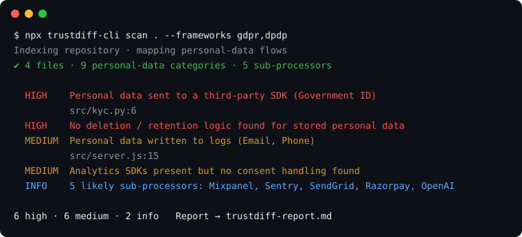

# trustdiff

**Find the gap between what you tell customers about privacy and what your code actually does.**

[](https://www.npmjs.com/package/trustdiff-cli)   

```bash
npx trustdiff-cli scan .
```



One command. Runs locally, zero dependencies, **never reads `.env` files, uploads nothing**.

---

## Why this exists

Your enterprise customer just sent a 150-question security questionnaire. *"Do you log personal data?" "List your sub-processors." "How long do you retain user data?"* Someone has to answer, usually the CTO, usually from memory.

And India's **DPDP Act** makes every enterprise and bank liable for its vendors, with core obligations enforceable from **13 May 2027**. Expect DPDP clauses and questionnaires in every renewal.

trustdiff reads your code and tells you what's *actually* true, so your answers are backed by evidence and your gaps get fixed before a customer finds them.

## What it checks

| Check | Example | Maps to |
|---|---|---|
| **Personal-data map** | email, phone, Aadhaar/PAN, bank/UPI, health, location, minors… and where each is *stored* | GDPR Art. 30 · DPDP s.5 |
| **PII in logs** | `console.log(\`OTP for ${email}\`)` | GDPR Art. 32 · DPDP Rule 6 |
| **PII sent to third parties** | raw email to Mixpanel, Aadhaar to an LLM | GDPR Art. 28 · DPDP s.8(2) |
| **Sub-processor register** | analytics, monitoring, email, SMS, payments, LLMs, cloud | GDPR Art. 28 |
| **Committed secrets** | AWS, Stripe, Razorpay, OpenAI, GitHub, DB URLs (masked in report) | GDPR Art. 32 · DPDP Rule 6 |
| **No deletion / retention** | stored PII with no erasure path | GDPR Art. 17 · DPDP Rule 8 |
| **Unhashed passwords / unencrypted sensitive fields** | PAN, bank account, salary in plain columns | GDPR Art. 32 · DPDP Rule 6 |
| **Tracking without consent** | analytics SDK, no consent logic | GDPR Art. 6/7 · DPDP s.6 |
| **Breach readiness** | no logging/monitoring → can't report in 72h | GDPR Art. 33 · DPDP Rule 7 |
| **Children's data · cross-border transfers** | age/guardian fields · data leaving India | DPDP s.9, s.16 |

The report also drafts answers to common **security-questionnaire questions**, each tagged `code` / `ops` / `policy` / `certification`, so you know which ones code can answer and which need a human.

## Usage

```bash
npx trustdiff-cli scan [path] [options]

  --frameworks gdpr,dpdp   frameworks to map findings to (default: both)
  --out <file.md>          Markdown report (default: trustdiff-report.md)
  --json <file>            also write JSON
  --ci                     exit 1 on any high-severity finding (for CI)
```

Supports JS/TS, Python, Prisma, SQL, plus `package.json` / `requirements.txt`. Sample report: [`examples/sample-report.md`](examples/sample-report.md) · try it: `npm run demo`.

## What it is not

A heuristic static scan. It produces **evidence for review, not a compliance certification**, and the GDPR/DPDP references are pointers for your counsel, not legal advice. Expect some false positives and misses. Ops, policy and certification questions still need a human.

## Roadmap

- [ ] GitHub Action (scan every PR)
- [ ] Suggested fixes as patches (with your approval)
- [ ] More languages (Go, Java, Ruby)
- [ ] Questionnaire import: map a customer's actual questionnaire to findings

## Need a questionnaire answered this week?

We run **72-hour security questionnaire + DPDP readiness sprints** for Indian SaaS teams: your real questionnaire, answered with evidence from your code.
→ **unnati.guptaaaaa@gmail.com**

Found a false positive? [Open an issue](https://github.com/UnnatiGupta0/trustdiff/issues). That's the fastest way to make the scanner better.

MIT © BeyondShell Technologies
